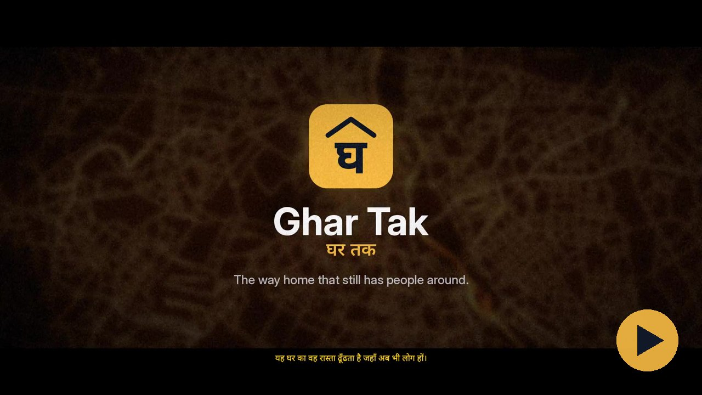

# Ghar Tak

[](media/ghar-tak-film.mp4)

*Watch the 2-minute film: English voice-over, Hindi captions. Click the image to play it.*

Night-time route comparison for **Delhi NCR**: all of Delhi, Gurugram and Manesar, Faridabad, Noida and Greater
Noida, Ghaziabad, Sonipat, Bahadurgarh and Bhiwadi.

Enter two places, say whether you're walking or in a cab, and pick when you're leaving. Ghar Tak finds up to three
different routes and scores each one for the hour you'll actually be on it: what's open beside the route, how long
the empty stretches are, how lit and busy it is, and how close help is. It shows the trade-off ("+4 min, but 30
open places instead of 6"), and you decide.

## Features

- **Night score per route**, recomputed for your departure time, with a breakdown of what drives it.
- **Best time to leave:** the route's score for every 30-minute departure from 6 pm to 3 am.
- **Along this route:** street lights (mapped lamps, `lit` tags, NASA night light), rush (an estimate from open
  places and bus routes, not live crowd data), CCTV, open shops, and the major bus routes that run along it.
- **Help along this route:** the nearest police stations and hospitals, where each sits along the trip, and a
  Call button where OSM or Overture lists a phone number.
- **Emergency:** an SOS button on every screen with 112, 1091 (Delhi Police women), 181 (women), 1098
  (Childline), 102 (ambulance) and 1090 (UP women), plus "message my trusted contacts with my location".
- **Trusted contacts:** saved only in your browser. One tap opens your SMS app with all of them filled in and the
  route, ETA and current location written; you press send. For several WhatsApp chats, use Share… → WhatsApp.
- **Teen mode:** stricter ranking (open places and short empty stretches count more), late-night and quiet-stretch
  warnings, guardian sharing and Childline 1098 on every route.
- **Walk + metro** across Delhi Metro, the Aqua Line, Rapid Metro Gurgaon and the RRTS, with both walking parts
  scored. It is only offered when the whole ride fits in the network's hours; otherwise the app says why.
  There are no train times (see Known limits).
- **Map layers:** show or hide each kind of place. CCTV points are always shown. An optional layer shows the
  major bus routes.
- **Trip mode:** tap Start trip on a route and Ghar Tak follows you along it on your phone:
  - it shows time and distance left, a live ETA, and what is coming up ("In 250 m: 630 m with nothing open",
    "Police in 600 m");
  - it asks "Are you OK?" if you leave the route, stop for 5 minutes (8 in a cab), run well past your
    arrival time, or start moving at vehicle speed on foot. No answer in 60 seconds sounds an alarm and
    gets a message to your trusted contacts ready to send;
  - on arrival, one tap tells everyone you reached.
  The rules are in [`lib/tripWatch.ts`](lib/tripWatch.ts). Websites can't run in the background or send texts
  by themselves, so Ghar Tak keeps the screen on and asks you to keep it open, and messages open in your SMS
  app for you to send.
- **Live link for your contacts:** with trip mode on, your contacts get a link (`/t/…`) that shows your
  position on the route, your ETA and your status, and turns red if you don't answer a check. It needs
  Upstash Redis (see Configuration) and is deleted an hour after the trip ends, or 12 hours after the last
  update.
- **Route image:** Share → Route image makes a picture of the route on the real map, with its score and key
  facts, for WhatsApp or Instagram.
- **Share a route:** the shared link carries the whole trip. The address bar itself stays clean, so where someone
  is going does not end up in browser history, screenshots or analytics; a reload of the tab still restores it.
- **Light and dark mode:** follows the device by default.
- **Feedback:** two-tap questions after each search, stored by the app and viewable at `/admin`.
- **Installable app (PWA):**
  - "Install app" on Android and desktop Chrome/Edge; Share → Add to Home Screen on iPhone.
  - It opens full screen, and the home-screen icon has an SOS shortcut.
  - Without a connection it opens from cache and shows every helpline.

## Data

Every value comes from these open sources:

| What | Source |
| --- | --- |
| Roads, `lit` tags, street lamps, CCTV, opening hours, metro and bus routes | OpenStreetMap extracts for Delhi, Haryana, Uttar Pradesh and Rajasthan, from [download.openstreetmap.fr](https://download.openstreetmap.fr/extracts/asia/india/) |
| Shops, eateries, hospitals, police, pumps, phone numbers | [Overture Maps](https://overturemaps.org) places (confidence ≥ 0.65), merged with OSM |
| Night light | NASA Black Marble VNP46A2 / VJ146A2 via [NASA GIBS](https://nasa-gibs.github.io/gibs-api-docs/), median of 30 recent passes |
| Routing, search, basemap | [OSRM](https://project-osrm.org) (FOSSGIS), [Photon](https://photon.komoot.io), [OpenFreeMap](https://openfreemap.org) |

Current build: 366,631 road ways; about 63,000 places; 3,251 mapped CCTV cameras; 194 major bus routes;
34 metro/RRTS line directions; phone numbers for 2,332 hospitals and 160 police stations.

## How the score works

Each route is sampled every 15 m on foot or 25 m by car, and each point is checked for the time you'd reach it.
The score is a weighted sum of:
- open places close by
- the longest stretch with nothing open
- light
- road type
- help within reach
- CCTV
- transit points

All the weights and thresholds are in `PARAMS` in [`lib/score.ts`](lib/score.ts), with teen-mode overrides in
`TEEN`. If a factor has no data near a route (usually CCTV), it's left out rather than scored as zero.

## Known limits

- **Opening hours are mostly estimates.** Only about 1 in 36 places publishes hours; the rest use category
  defaults (eateries 11 am–11 pm, for example), and the map labels them as assumed.
- **Not live.** No live crowd, traffic or incident data. Rush is an estimate.
- **No train times.** DMRC's timetable isn't openly licensed, so walk + metro uses estimated ride times and
  reminds you to check the last train. Service hours are the usual published ones (`SERVICE_HOURS` in
  [`lib/metro.ts`](lib/metro.ts)): Delhi Metro about 6 am–11 pm; Noida Metro and Namo Bharat 6 am (8 am on
  Sundays) to 10 pm; Rapid Metro Gurugram about 6 am–10 pm. Event days (IPL matches, Diwali) change them.
- **Uneven coverage.** CCTV and police phone numbers are sparse outside central Delhi. Satellite light is coarse
  (about 500 m per pixel).
- **Not a safety guarantee.** It helps you compare options. In an emergency, call 112.

## Running it

```bash
npm install
npm run dev            # http://localhost:3000
```

The datasets in `data/` are committed. To rebuild them (about 10 minutes, roughly 360 MB of downloads):

```bash
pip install osmium duckdb numpy pillow
npm run data
```

### Configuration

| Variable | Purpose |
| --- | --- |
| `ADMIN_PASSWORD` | Optional. Changes the `/admin` password (the built-in one is stored only as a scrypt hash). |
| `KV_REST_API_URL`, `KV_REST_API_TOKEN` | Upstash Redis: needed for live trip links, and used for feedback answers (set automatically by Vercel's Upstash integration; `UPSTASH_REDIS_REST_URL`/`_TOKEN` also work) |
| `FEEDBACK_FILE` | Where answers are stored on a host with a persistent disk (default `.data/feedback.jsonl`) |
| `FEEDBACK_WEBHOOK_URL`, `FEEDBACK_SHEET_ID` | Override the Google Sheet set in `lib/sheet.ts` |
| `OSRM_CAR_URL`, `OSRM_FOOT_URL` | Your own OSRM servers (recommended for heavy traffic) |
| `ORS_API_KEY` | Backup router: when the public OSRM servers fail or refuse, routes come from [OpenRouteService](https://openrouteservice.org) instead (free key, 2,000 routes a day). Without it there is no backup. |

### Admin and feedback data

`/admin` asks for the admin password; nothing needs setting up. The repo stores only a salted scrypt hash of it, and
wrong attempts are limited to 5 per 10 minutes. To change the password, set `ADMIN_PASSWORD` on your host. The page
shows every answer, a summary, and **Download CSV**, which reads the latest data on each click.

Where answers are saved depends on the host:

| Host | What to do |
| --- | --- |
| **Vercel / Netlify** (read-only disk) | In Vercel: project → **Storage** → **Create Database** → **Upstash Redis** (free tier) → connect it to the project → redeploy. The connection variables are added for you. Until then, answers go to temporary storage and `/admin` shows a warning. |
| **A VM, Railway, Render, or Fly with a volume** | Nothing: answers go to `FEEDBACK_FILE` (default `.data/feedback.jsonl`). |
| **Google Sheet (recommended)** | Every answer becomes a row in your sheet, on any host. Open the sheet → Extensions → Apps Script → paste `scripts/feedback/Code.gs` → Deploy → Web app (execute as you, access Anyone) → copy the `/exec` URL. Put that URL and the sheet's ID in [`lib/sheet.ts`](lib/sheet.ts). `/admin` then shows the sheet itself. |

What's stored:
- the answers
- the scores and times of every route shown
- the hour
- start and end rounded to about 1 km
- the route that was selected on screen: its main roads, distance, time, score breakdown, open places, longest
  empty stretch, lamps, CCTV and bus routes
- a coarse outline of that route, with every point within 400 m of the start or end removed

No names, exact addresses or IP addresses.

Page views are counted with Vercel Web Analytics, which uses no cookies. Only the page path is sent: a shared
route's link (which contains the trip) is cut to `/`, and `/admin` is not counted.

## Licences

- OpenStreetMap data © OpenStreetMap contributors, [ODbL 1.0](https://opendatacommons.org/licenses/odbl/). The
  files in `data/` are derived databases under the same licence.
- Overture Maps places: [CDLA Permissive 2.0](https://cdla.dev/permissive-2-0/).
- NASA Black Marble imagery courtesy of NASA EOSDIS GIBS.
