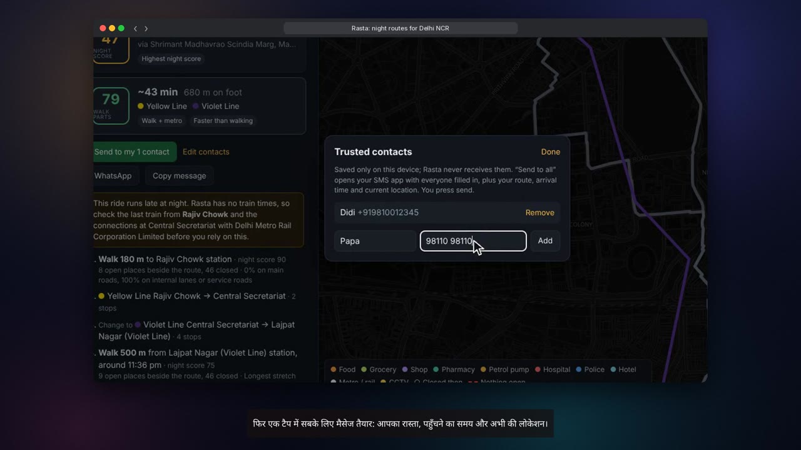

# Rasta

Night-time route comparison for **Delhi NCR**: all of Delhi, Gurugram and Manesar, Faridabad and Ballabgarh,
Noida and Greater Noida (up to the Jewar airport site), Ghaziabad, Sonipat and Kundli, Bahadurgarh and Bhiwadi.

## Walkthrough (89 seconds)

[](docs/rasta-walkthrough.mp4)

**[Watch the walkthrough (MP4, 1080p, 13.5 MB)](docs/rasta-walkthrough.mp4)**: Indian-English voice-over, Hindi
captions burned in. Caption files: [Hindi](docs/rasta-walkthrough.hi.srt), [English](docs/rasta-walkthrough.en.srt).

It's a real recording of the app, with no mock-ups, shown in a macOS-style browser window with the cursor, clicks
and zooms visible. It follows Connaught Place to Lajpat Nagar Central Market on foot at 11 pm:

- the open and closed places and empty stretches
- the score breakdown and the best-time-to-leave chart
- walk + metro (Yellow Line to Central Secretariat, Violet Line to Lajpat Nagar) with the late-night warning
- adding a trusted contact and sending to all
- the feedback form
- switching to light mode

The voice is synthetic: Piper's Hindi voice `hi_IN-pratham-medium` reading the English script written
phonetically in Devanagari, which gives Indian-accented English. That voice is CC BY-NC-SA 4.0, so the video is
too. [`docs/video/`](docs/video) has the script and the tools to rebuild the video, or to swap in a recorded
voice.

<details>
<summary>Narration and Hindi captions</summary>

| English (voice-over) | हिंदी (कैप्शन) |
| --- | --- |
| This is Rasta, a night-time route checker for Delhi NCR. Most maps show you the fastest way home. Rasta shows you which way has people around. | यह है रास्ता: दिल्ली NCR के लिए रात के रास्तों की जाँच। ज़्यादातर मैप सबसे तेज़ रास्ता दिखाते हैं। रास्ता दिखाता है कि किस रास्ते पर लोग आसपास हैं। |
| Pick where you're going, walking or a cab, and when you're leaving. Rasta finds up to three different routes, and scores each one for the hour you'll actually be on it. | कहाँ जाना है, पैदल या कैब, और कब निकलना है: चुनिए। रास्ता तीन तक अलग-अलग रास्ते ढूँढता है और हर एक को उसी समय के हिसाब से स्कोर करता है जब आप वहाँ होंगे। |
| It checks what's open along the way: shops, chemists, petrol pumps and hospitals. Hollow pins will be closed when you pass. Red dashes are stretches with nothing open. | यह देखता है कि रास्ते में क्या खुला है: दुकानें, केमिस्ट, पेट्रोल पंप और अस्पताल। खाली गोले आपके गुज़रते समय बंद होंगे। लाल डैश वे हिस्से हैं जहाँ कुछ भी खुला नहीं। |
| The score also weighs the type of road, NASA's satellite night light, CCTV mapped in OpenStreetMap, and how close help is. | स्कोर सड़क का प्रकार, NASA की सैटेलाइट रात-रोशनी, OpenStreetMap में दर्ज CCTV, और मदद कितनी पास है, यह सब भी देखता है। |
| This chart shows how the route changes through the evening, so you can pick the best time to leave. | यह चार्ट दिखाता है कि शाम भर रास्ता कैसे बदलता है, ताकि आप निकलने का सबसे अच्छा समय चुन सकें। |
| On foot, Rasta can also suggest walking plus metro, and reminds you to check the last train late at night. | पैदल चलने पर रास्ता पैदल + मेट्रो का विकल्प भी सुझाता है, और देर रात आख़िरी ट्रेन जाँचने की याद दिलाता है। |
| Save your trusted contacts once. Then one tap gets a message ready for all of them, with your route, arrival time and current location. | भरोसेमंद लोगों को एक बार सेव कीजिए। फिर एक टैप में सबके लिए मैसेज तैयार: आपका रास्ता, पहुँचने का समय और अभी की लोकेशन। |
| And a two-tap question after each search helps tune the score with real answers. | हर खोज के बाद दो टैप के सवाल, असली जवाबों से स्कोर को बेहतर बनाते हैं। |
| Prefer it bright? There's a light mode too. | रोशनी पसंद है? लाइट मोड भी है। |
| Built only on open data. It doesn't promise safety. It helps you choose. Rasta. For the ride home. | सिर्फ़ ओपन डेटा पर बना। यह सुरक्षा का वादा नहीं करता, चुनने में मदद करता है। रास्ता: घर तक के सफ़र के लिए। |

</details>

The coverage box is 28.14–29.02 °N, 76.80–77.70 °E, which is the continuous urban belt around Delhi. Statutory
NCR also includes distant districts such as Meerut, Panipat, Rohtak and Alwar; those are outside the box for now.

Give it two places, say whether you're walking or in a cab, and pick when you're leaving. Rasta fetches up to three
genuinely different routes and scores each one for the hour you'll actually be on it:

- how much of it has an open shop, eatery, chemist, petrol pump, hospital or station right beside it,
- the longest stretch with nothing open, and whether that stretch is dark,
- how bright it is at night (from satellite data), and whether it uses main roads or internal lanes,
- whether an open hospital or police station is within reach, plus mapped CCTV and transit points.

It doesn't pick a route for you. It shows the trade-off ("+4 min, but 30 open places instead of 6 and no 2 km
dead stretch") and lets you decide.

Two more things on each route:

- **Best time to leave.** A bar chart of the route's night score for every 30-minute departure from 6 pm to
  3 am, with the best window called out ("Best to leave 6 pm–8:30 pm (score 54). Leaving at 9 pm scores 50").
  Tap a bar to rescore at that time.
- **Share my route.** The whole trip lives in the URL, so a link reopens the same places, mode, departure time
  and selected route, including walk + metro.
- **Send to all your trusted contacts.**
  - Save a few contacts once: pick them from the phone's contacts where the browser supports it (Android Chrome),
    or type them in.
  - "Send to my N contacts" gets your current location and opens your SMS app with every contact filled in and the
    message written: where you're going, when you left, when you should arrive, the route link and a Google Maps
    link to where you are now. You press send.
  - Contacts are stored only in your browser; Rasta's server never receives them.
  - Websites can't send messages on their own, and WhatsApp links take one number at a time. So for several
    WhatsApp chats, use **Share…** and pick the chats in WhatsApp.
- **Light and dark mode.** Follows the device by default; the header toggle cycles Auto → Light → Dark and
  remembers the choice. The map switches to a light basemap with darker pin colours so everything stays readable.

On foot, Rasta also looks for a **walk + metro + walk** option across Delhi Metro, Noida's Aqua Line, Rapid
Metro Gurgaon and the Delhi–Meerut RRTS, using the lines and ordered stops mapped in OpenStreetMap. It is shown
when it beats walking, with each walking leg scored at the time you'd be on it.

Train times are **not** included. DMRC's official timetable (GTFS) is only available from Delhi's Open Transit
Data portal under terms that require registration and prohibit modifying or repurposing the data, so Rasta
estimates the ride instead and says so in the app:

- 32.6 km/h between stations (straight-line). This comes from the one complete OSM line with a `duration` tag:
  the Red Line, 32.6 km in 60 min. It is applied to every line, which is conservative for the faster RRTS.
- 8 min waiting each time you board (night headways are longer), plus 3 min and the walk between platforms for
  each change. Stops of different lines within 350 m count as one interchange.
- If any part of the ride falls between 10:30 pm and 6 am, the card tells you to check the last train with the
  operator.

## Feedback: tuning the score with real answers

The weights in the night score are a starting point, not something measured. To check them, each set of
results ends with a short, optional, anonymous form:

1. **Which of these would you actually take?** (each route shown, walk + metro, or none)
2. **What matters most to you on this trip?** (fastest / people and open shops / well-lit streets / main
   roads / a route I know)
3. *(optional)* **Do you know this area at night?** (feels safe / some stretches don't / feels unsafe / don't know)

Each answer becomes one row in a Google Sheet, alongside the scores, times and component values of the routes
that were shown. Over time that answers concrete questions: do people pick the highest-scoring route or the
fastest one, at which hours, and does a low "open places" or "light" value line up with areas people say feel
unsafe?

**What is stored:** the answers, the routes' scores, durations and component values, the departure hour, and
the start and end rounded to 0.01° (about 1 km). **Not stored:** names, exact addresses, IP addresses or any
free text. The form is asked once per trip per browser session and can be dismissed.

**Setup** (the form stays hidden until this is done):

1. Open the feedback Google Sheet, then Extensions → Apps Script. Paste
   [`scripts/feedback/Code.gs`](scripts/feedback/Code.gs) and save.
2. Project Settings → Script properties → add `SECRET` with a long random value.
3. Deploy → New deployment → Web app. Execute as **Me**, access **Anyone**. Copy the web app URL.
4. Set `FEEDBACK_WEBHOOK_URL` (that URL) and `FEEDBACK_SECRET` (the same secret) in the app's environment.

Inspired by [this demo](https://x.com/achinamayya/status/2115794397489205740), rebuilt for Delhi NCR on open data only.

## Data

Every number in the app comes from one of these sources. Nothing is generated or invented.

| What | Source | Notes |
| --- | --- | --- |
| Roads, `lit` tags, street lamps, CCTV, opening hours | OpenStreetMap: Delhi, Haryana, Uttar Pradesh and Rajasthan (for Bhiwadi) extracts from [download.openstreetmap.fr](https://download.openstreetmap.fr/extracts/asia/india/) | 3,251 mapped cameras and 1,540 street lamps in the box; 1,737 places carry `opening_hours`. |
| Shops, eateries, ATMs, hotels, hospitals, police, pumps | [Overture Maps](https://overturemaps.org) places, release `2026-10-21.0` | Much denser than OSM for Indian businesses. Only places with confidence ≥ 0.65 are kept; Overture duplicates of OSM places (same kind, within 40 m) are dropped. |
| Night light | NASA Black Marble VNP46A2 / VJ146A2 (gap-filled, BRDF- and moonlight-corrected radiance) via [NASA GIBS](https://nasa-gibs.github.io/gibs-api-docs/) | Per-pixel median of the last 15 nights from both Suomi-NPP and NOAA-20 (30 passes). GIBS greyscale is converted back to nW/cm²/sr with GIBS's published colour map. |
| Routes | [OSRM](https://project-osrm.org) car and foot profiles on FOSSGIS's public servers | Router alternatives plus detours via the nearest main road on either side of the direct line. |
| Search | [Photon](https://photon.komoot.io) (komoot), restricted to the coverage box | |
| Basemap | [OpenFreeMap](https://openfreemap.org) dark style | |

Counts in the current build (`data/meta.json`): 366,631 road ways; 25,317 shops, 12,474 eateries, 4,800
grocery/convenience stores, 5,910 hotels, 4,599 ATMs, 3,671 hospitals, 2,032 pharmacies, 1,181 metro/rail stations,
1,260 petrol pumps, 911 malls, 512 police stations, 2,647 bus stops.

## How the night score works

Code: [`lib/score.ts`](lib/score.ts). Every threshold and weight lives in `PARAMS` there.

Each route is sampled every **15 m on foot / 25 m by car**. Each sample gets a timestamp from the departure time
plus the router's travel time to that point, so a 40-minute walk that starts at 10:40 pm is checked against shops
closing at 11.

| Component | What it measures | Walk weight | Drive weight |
| --- | --- | --- | --- |
| Open places | Share of samples "watched": open places within 45 m (walk) / 70 m (drive) whose weights sum to ≥ 0.7. Hospital, police, pump, chemist, eatery, grocery, mall, station = 1; hotel 0.8; other shop 0.6; ATM 0.4. Places whose hours are assumed (see below) count ×0.75. | 28% | 20% |
| No long empty stretch | 1 − (worst stretch with nothing open ÷ 600 m walk / 4 km drive). A stretch's effective length is scaled by darkness: fully dark counts in full, fully lit at half. | 20% | 17% |
| Light | Satellite radiance mapped linearly from 8 (dark) to 36 (bright) nW/cm²/sr. OSM `lit=yes` or a mapped street lamp within 30–40 m lifts a sample to ≥ 0.85; `lit=no` caps it at 0.25. | 15% | 15% |
| Road type | Each sample is snapped to the nearest OSM way within 20 m (preferring ways aligned with the route, so junctions don't snap to the cross street). Walking: primary/secondary 1.0, tertiary 0.8, residential 0.5, service 0.3, footpath 0.15–0.35, track 0.1. Driving: motorway/trunk/primary 1.0, secondary 0.85, tertiary 0.65, residential 0.35, track 0.05. | 15% | 30% |
| Help nearby | Share of samples with an open hospital or police station within 500 m (walk) / 1 km (drive). | 8% | 10% |
| CCTV | Mapped cameras within 35 m / 50 m per km, full marks at 4/km (walk) or 3/km (drive). | 7% | 8% |
| Transit points | Metro, rail and bus stops within 120 m per km, full marks at 3/km. Walking only. | 7% | 0% |

The score is the weighted sum × 100. If a component has **no data** for the route, its weight is shared among
the others instead of scoring it as zero. In practice this means CCTV: no camera mapped within 1.5 km of the route.
If less than 60% of a route lies inside the coverage box, it gets no score.

### Opening hours

Only about 1 in 36 places in the dataset (1,734 of 62,667) has hours in OpenStreetMap, and Overture carries none. When a place has a real
`opening_hours` tag it is evaluated exactly (with [opening_hours.js](https://github.com/opening-hours/opening_hours.js),
in IST). Otherwise Rasta uses a **category default** and labels the place "hours assumed" in the map popup:

| Category | Assumed hours |
| --- | --- |
| Hospital, police, hotel, ATM | 24/7 |
| Petrol pump | 06:00–23:00 |
| Pharmacy | 09:00–22:00 |
| Eatery | 11:00–23:00 |
| Grocery / convenience | 08:00–22:00 |
| Other shops | 10:30–21:00 |
| Mall | 10:00–22:00 |
| Metro / rail station | 05:30–23:30 |

These defaults are deliberately conservative for late night. If you know a stretch better, the fastest fix is to
add `opening_hours` to those places in OpenStreetMap, which will show up in the next data build.

## Known limits

- **Hours are mostly estimates.** See above. The route card says how many places on the route have real hours.
- **Satellite light is coarse.** About 500 m per pixel, and NASA's visualised product saturates at 38.2 nW/cm²/sr,
  so it separates dark belts (the Aravalli ridge, the Yamuna floodplain, unbuilt sectors on the city edge) from
  lit areas well, but can't see one dark lane inside a bright sector. OSM `lit` tags and lamps refine this where
  they exist.
- **CCTV mapping is uneven.** Dense around Connaught Place, Lodhi Road and South Delhi; sparse in most of
  Gurugram, Noida, Faridabad and Ghaziabad.
  This is why "no data" is handled separately from zero.
- **Public holidays are not modelled.** opening_hours.js has no Indian holiday calendar, so `PH` rules are ignored.
- **Not live.** Rasta can't know about a closed road, a power cut or what's happening on a street tonight. It
  helps you weigh options; it isn't a safety guarantee.

## Running it

```bash
npm install
npm run dev            # http://localhost:3000
```

The built datasets are committed in `data/` (gzipped), so the app runs without rebuilding them. The API loads
them once per server process: about 2 s on a cold start, then each request takes well under a second plus
routing time.

### Rebuilding the data

```bash
pip install osmium duckdb numpy pillow
npm run data           # = python3 scripts/build_data.py
```

This downloads about 360 MB of OSM extracts into `.cache/`, queries Overture's public S3 bucket anonymously, pulls
30 nights of VIIRS imagery from GIBS, and rewrites `data/`. It takes about 5 minutes. The coverage box, categories,
assumed hours and the Overture confidence threshold are all at the top of
[`scripts/build_data.py`](scripts/build_data.py).

### Configuration

| Variable | Default | Purpose |
| --- | --- | --- |
| `OSRM_CAR_URL` | FOSSGIS `routed-car` | OSRM `/route/v1/driving` base URL |
| `OSRM_FOOT_URL` | FOSSGIS `routed-foot` | OSRM `/route/v1/foot` base URL |
| `ROUTER_USER_AGENT` | `rasta/0.1 …` | Sent to the router |
| `FEEDBACK_WEBHOOK_URL` | unset (form hidden) | Apps Script web app that appends feedback rows |
| `FEEDBACK_SECRET` | unset | Shared secret checked by the Apps Script |

FOSSGIS's servers are fine for trying this out, but they're a shared, donated resource. Before sharing the app
widely, run your own OSRM (an NCR-sized graph fits comfortably on a small VM) and point the variables at it.

## Layout

```
scripts/build_data.py   data pipeline (OSM + Overture + VIIRS → data/)
data/                   built datasets, read by the API at runtime
lib/data.ts             loads data, spatial grid index, radiance lookup
lib/routing.ts          OSRM candidates, via-point detours, de-duplication
lib/score.ts            the night score
lib/hours.ts            opening_hours evaluation in IST
lib/metro.ts            walk + metro planner over OSM metro lines (Dijkstra, estimated ride times)
lib/trip.ts             request validation, 15-minute cache of router candidates
app/api/routes          POST {from, to, mode, depart} → scored routes
app/api/feedback        GET → {enabled}; POST anonymous answers → Google Sheet via Apps Script
app/api/timeline        POST {from, to, mode, depart} → each route's score every 30 min, 6 pm–3 am IST
components/             UI (MapLibre map, search, route cards, departure chart, share)
docs/                   walkthrough video, captions, and docs/video/ to rebuild it
lib/theme.ts            light/dark mode (lib/theme-boot.ts sets it before first paint)
```

## Name ideas

"Rasta" is the working name. Some alternatives, chosen to describe what the app measures without promising
safety (a name like "SafeRoute" implies a guarantee the data can't back):

| Name | Meaning | Why it fits | Watch out for |
| --- | --- | --- | --- |
| **Jagmag** | Lit up, bustling (जगमग) | Exactly what the score looks for: light and life on the street | Playful tone; check app-store and domain availability |
| **GharTak** | All the way home (घर तक) | Says the purpose plainly; matches the "for the ride home" line | Two words joined; spelling varies (Ghar Tak) |
| **Chahal** | From चहल-पहल, people moving about | The core idea, eyes on the street, in one word | Also a common surname |
| **Raat Rasta** | Night route (रात रास्ता) | Descriptive, easy to search, keeps the current name | Long-ish for an app icon |
| **Jaagti Raah** | The road that's awake (जागती राह) | Evocative; night plus activity | Harder to type and spell in English |
| **Roshan Raah** | Lit path (रोशन राह) | Simple, positive | Light is only one of seven factors |
| **Rasta** (current) | Route (रास्ता) | Short, everyone in NCR knows the word | Very generic: hard to search for, many existing apps use it |

Names I'd avoid: *Ujala* (a well-known existing brand) and *Raahgiri* (Gurugram's long-running car-free street
event). None of the names above have been checked for trademarks, domains or app-store listings; do that before
picking one. The video and app copy say "Rasta"; [`docs/video/README.md`](docs/video/README.md) explains how to
regenerate the video under a new name.

## Licences and attribution

- OpenStreetMap data © OpenStreetMap contributors, [ODbL 1.0](https://opendatacommons.org/licenses/odbl/). The
  files in `data/` are derived databases and are shared under the same licence.
- Overture Maps places: [CDLA Permissive 2.0](https://cdla.dev/permissive-2-0/) with source attribution as listed
  in the Overture release notes.
- NASA Black Marble imagery courtesy of NASA EOSDIS GIBS.
- Walkthrough narration: Piper voice `hi_IN-pratham-medium` by PravalX, trained on AI4Bharat's IndicNLP corpus,
  [CC BY-NC-SA 4.0](https://creativecommons.org/licenses/by-nc-sa/4.0/). The video
  (`docs/rasta-walkthrough.mp4`) is shared under the same licence.
